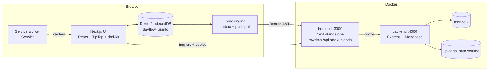

# Dayflow — Architecture

Offline-first, multi-user daily tasks + permanent notes. All dates/times are **Asia/Dhaka (UTC+6)**.

## 1. System diagram

### Windows desktop companion

The Electron desktop package loads the shared hosted frontend in a persistent partition. A separate local bubble opens the same workspace in compact or expanded presentation. Native state uses a versioned isolated preload bridge; task/note logic remains in the frontend's Dexie/outbox layer. Browser and desktop caches are independent.

Browser-based Google sign-in uses an expiring, proof-bound MongoDB handoff. User-scoped SSE at `/api/sync/events` triggers normal push/pull, retaining polling recovery. The notification bus supports the current single backend process. Docker builds use Node 24 to match dependency requirements. See the [Desktop guide](DESKTOP.md).

Only the frontend port (default 3000) is published. `/api/*` and `/uploads/*` are proxied by Next `rewrites` to `http://backend:4000`, so the app is single-origin (no CORS).

## 2. Layers

### Android and shared packages

`mobile/` owns the React Native/Expo Android client. `packages/shared` contains
platform-independent contracts, Dhaka/reminder rules and merge/order helpers.
`packages/editor` builds the compatible TipTap extension configuration using
caller-supplied modules: each platform must have a single ProseMirror runtime.

Android's Kotlin SQLite repository is the common source of truth for the native
app, overlay, widget and notifications. A shared JavaScript sync coordinator runs
while the app is foregrounded or the user-enabled overlay is visible. Native
surfaces queue transactions when networking is inactive. The bundled system
WebView editor receives content/formatting messages and native-fetched image data,
never credentials. Canonical HTML stores server URLs or pending upload IDs, never
device paths. Database accounts, image storage and secure sessions are isolated.

Release APKs use a persistent private signing key, ARM64/Hermes, minimum API 31
and target API 36. Native projects are generated from configuration/plugins;
project-owned Kotlin remains under `mobile/modules`. Build and lifecycle details
are in [Android guide](ANDROID.md); actual release evidence is tracked separately
in [Android verification](ANDROID_VERIFICATION.md).

### Frontend (`frontend/src`)
- `app/` — App Router: `(auth)/login`, `(app)/` shell (icon rail, notes sidebar, top bar), `(app)/page.tsx` Home, `(app)/history`, `sw.ts`.
- `components/` — `ui/` primitives, `tasks/`, `notes/`, `editor/`, `layout/`.
- `lib/` — `db.ts` (Dexie), `sync.ts`, `api.ts`, `time.ts` (Dhaka helpers), `order.ts` (fractional ordering).
- `hooks/` — `useTasks`, `useNotes`, `useSyncStatus`, `useDhakaToday`, `useAuth`.
- **IndexedDB is the UI's source of truth.** Reads via `useLiveQuery`; writes go to Dexie then to the outbox.

### Backend (`backend/src`)
Modular: `modules/<name>/{interface,model,validation,service,controller,route,test}`.
- route = path + middleware + controller; controller = typed req → service → res (no DB calls); service = business logic + Mongoose; model = schema/indexes.
- Cross-module access only through exported services (e.g. `sync.service` → `task.service.upsertMany`).
- `middleware/`: `auth`, `requireRole`, `validate` (zod), `errorHandler`. `utils/`: `dhaka`, `sanitize`, `AppError`, `catchAsync`.
- No seeding: Super Admins are the emails in `SUPERADMIN_EMAILS` (promoted when they sign in) or users whose `role` is edited in the database.

## 3. Auth flow (header + cookie)
1. The login page shows the Google button (client id from `GET /api/auth/config`). `POST /api/auth/google` verifies the ID token, creates or updates the user, then returns `{ token, user }` and sets httpOnly cookie `dayflow_token` (SameSite=Lax, Secure per `COOKIE_SECURE`, 30 days).
2. Client stores the JWT + user profile in IndexedDB `meta` (offline sessions) and sends `Authorization: Bearer` on all `fetch` calls.
3. The cookie exists so `` works (image requests send no headers).
4. **CSRF rule:** `auth` middleware accepts the cookie only for safe `GET`; `POST/PUT/PATCH/DELETE` require the Bearer header.
5. On start with a stored token but missing cookie, `GET /auth/me` (Bearer) re-sets the cookie. Logout and a 401 on `/auth/me` clear it.
6. Offline: app opens straight into the cached session. A 401 during sync keeps local data and asks to sign in again.
7. No passwords exist. JWT HS256, 30 d. `requireRole` re-reads the role from the database, so role changes and removed accounts apply immediately.

## 4. Offline-first & sync
- Client IDs: `crypto.randomUUID()` used as Mongo `_id` (string) → no remapping.
- Soft deletes via `deletedAt` tombstones; server purges tombstones > 30 days (at boot and every 24 h).
- One Dexie DB per user: `dayflow_<userId>`.
- Triggers: app start, `online`, every 30 s, 1 s after a local write (debounced), `visibilitychange`, and authenticated SSE notifications. One stream leader per user/browser partition receives live notifications; reconnect triggers a pull and polling remains a fallback.
- Steps: (1) upload pending image blobs, rewrite `blob:` src in HTML → (2) push outbox in batches of 100 (`POST /sync/push`) → (3) pull (`GET /sync/pull?since=`), merge into Dexie, store `lastPulledAt = serverTime`.
- Conflict: last-write-wins per document by `updatedAt`; server returns the winner.
- Outbox items are removed only after server ack; exponential backoff 1 s → 60 s. A document whose HTML still references an un-uploaded image (`data-local-id`) is held back until its images are uploaded.
- A server that cannot be reached is shown as **Offline** (even if `navigator.onLine` is true). A 401 flags the session as expired, keeps every local change, and sync resumes automatically after signing in again.
- `navigator.locks` (`dayflow-sync`) ensures one syncing tab; `BroadcastChannel` tells other tabs to refresh.
- Service worker (Serwist): precache shell/fonts/static; CacheFirst `/uploads/*` (60 d, 300 entries); navigation fallback for `/`, `/history`, `/login`; PWA manifest.

## 5. Time rules
- `dhakaNow()`, `dhakaDateKey()`, `formatDhaka()` on both sides. Tasks carry `taskDate: "YYYY-MM-DD"` (the Dhaka day at creation).
- `useDhakaToday()` re-checks every 30 s and on focus/visibility → board flips to the new day at midnight. Tasks never carry over.
- Server accepts a `taskDate` that is valid and ≤ Dhaka today + 1 day.

## 6. Ordering
Fractional `orderIndex`: between A,B → (A+B)/2; top → first−1024; bottom → last+1024; renormalize (1024, 2048, …) if gap < 1e-6.

## 7. Docker topology
- `mongo` (`mongo:7`, healthcheck ping), `backend` (`node:24-alpine`, waits for healthy mongo), `frontend` (`node:24-alpine`, Next standalone).
- Volumes: `mongo_data:/data/db`, `uploads_data:/app/uploads`. `TZ=Asia/Dhaka`, `restart: unless-stopped`, non-root users, multi-stage builds.
- Build stage runs `npm run typecheck` and `npm run lint` before building → any type error fails `docker compose up -d --build`.

## 8. Testing
- `backend`: Vitest + supertest + `mongodb-memory-server`, one test file per module (`npm test`; runs on the host, not in Alpine).
- `frontend`: Vitest (Dhaka date logic, fractional ordering, LWW merge, sync engine on fake-indexeddb + jsdom) and Playwright e2e against a throwaway stack (`e2e/stack.mjs`: in-memory MongoDB + backend + built Next): offline→online, offline images, image via cookie, CSRF, paste formatting, drag and drop, history/copy, auth, midnight rollover, responsive, axe accessibility (light + dark).

## 9. UI design notes (from reference images in `/references`)
Tokens: spec §4.1 (CSS variables + `tailwind.config.ts`). Deviations: `--text-muted` is `#6B6B6B` (the spec's `#9A9A9A` fails WCAG AA on white) and `--st-completed-fg` is `#15803D` for the same reason; "completed" cards fade their surface to 70% instead of the whole card so the text keeps AA contrast. Details observed in the references:
- **Shell frame (ref1):** thick soft white ring, ~40px radius, large shadow; inner panels are separate white rounded panels with 16–20px gaps.
- **Icon rail (ref2/3):** separate white pill groups — theme (sun/moon), nav (middle), help/logout (bottom). Active = solid black circle.
- **Greeting (ref2):** very large bold heading, tight tracking, muted subtitle.
- **Info banner:** white strip, gradient icon tile, bold lead + text, light pill button on the right.
- **Stat tiles:** white cards, round icon tile on the left, bold number + muted label; pastel icon circles.
- **Segmented control:** muted container, white active pill, leading icons.
- **Primary button:** black pill, white circle with `+`, soft drop shadow.
- **Gradient-outline pill:** blue→pink→orange border, white fill ("Est: **1h 30m**").
- **Column header:** white bar, 3px colored left accent, title, count badge, `⋮`.
- **Task card:** muted card, `#01` chip, title, 2-line description, gradient pill, divider, footer.
- **Profile card (ref1):** avatar ring overlapping gradient header, inner white card, blue→purple bottom glow.
- **Top bar:** breadcrumb pills, mint "Synced" pill with green dot, date pill, avatar.

## 10. UI revision (task board + shell)
- **Shell:** full-bleed. No outer canvas, ring or big radius. From 1024px the sync pill, Dhaka date and avatar sit at the top of the notes sidebar (there is no logo and no main top bar); below 1024px a slim top bar carries them plus the notes-drawer button.
- **Home header:** "Today's tasks" + "Tuesday 20 October · resets at midnight", Board/List tabs, "Add task". The greeting block was removed.
- **Board:** each column is a soft grey panel with a white header (accent bar orange / indigo / green, count, "+" that opens the editor with that status) and white cards.
- **Task card:** `#NN` chip, optional "From 19 Oct" chip, hover/touch actions (drag grip, edit, delete), title, 2-line description, divider, footer with the gradient estimate pill ("No estimate" when 0) and a one-tap action (Start / Complete / Reopen; the card moves to the end of its new column). List view also shows the status dropdown chip. Cards and handlers are memoized.
- **Task editor:** chip header ("Edit task", "Transferred from …"), boxed rich-text editor with the toolbar inside, h/m inputs, status segmented control (orange active label), soft-red Delete, "Save task".
